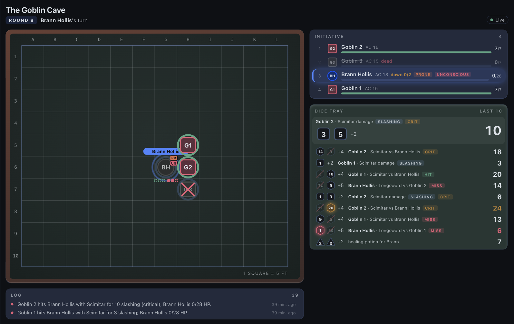

# Tablekeeper

Tabletop campaigns in a Hermes chat where code rolls every die and the model only narrates.




## What it does

Tablekeeper turns a Hermes chat into a table for a D&D 5e style campaign. Python owns hit points, positions, initiative and turn order, and the model calls `tk_` tools and narrates what comes back. Each player controls only the character they claimed, and in combat only on that character's turn. Monsters play their own turns from SRD 5.1 stat blocks the moment a player ends theirs. A narration guard appends a visible correction when the model states a number no tool produced. The Desktop Tabletop pane draws the battle grid, initiative order and dice tray from the same campaign database, read-only.

## A real turn

Played live in the Hermes CLI with `nvidia/nemotron-3-ultra-550b-a55b:free` through OpenRouter. The dice are the plugin's.

```text
You:      /table new The Goblin Cave
You:      /table claim fighter
You:      Brann the fighter faces the goblins of the Goblin Cave. Start combat with 3 goblins.
  tk_start_combat -> initiative: Goblin 2 16, Goblin 3 14, Brann 13, Goblin 1 4. Goblin 2's shortbow: d20 20 + 4 = 24 against AC 18, critical, 9 piercing. Goblin 3: d20 10 + 4 = 14, miss.
Hermes:   Goblin 2 fires a shortbow from 55 feet: natural 20, CRITICAL HIT (total 24 vs AC 18) for 9 piercing damage.
          Goblin 3 fires: natural 10 (total 14) vs AC 18, MISSES. Brann Hollis: 19/28 HP. Your turn.
You:      I attack Goblin 3 with my longsword.
  tk_attack         -> Longsword d20 11 + 5 = 16 against AC 15: hit, 12 slashing. Goblin 3 dead.
Hermes:   Longsword attack on Goblin 3 (5 ft, melee): natural 11 (total 16) vs AC 15, HIT for 12 slashing damage. Goblin 3 is slain.
```

## Install

```bash
hermes plugins install kaverimeshram/tablekeeper/tablekeeper --enable
```

Requires Hermes 0.23.1 or newer. Send `/table new` in the chat where the game happens. Tools, commands, storage and the SRD attribution are in the [plugin README](tablekeeper/README.md).

## Tests

```bash
python -m unittest discover -s tests -t .
```

## License

MIT, see [LICENSE](LICENSE). SRD 5.1 content is used under CC-BY-4.0, see [NOTICE](tablekeeper/NOTICE).
