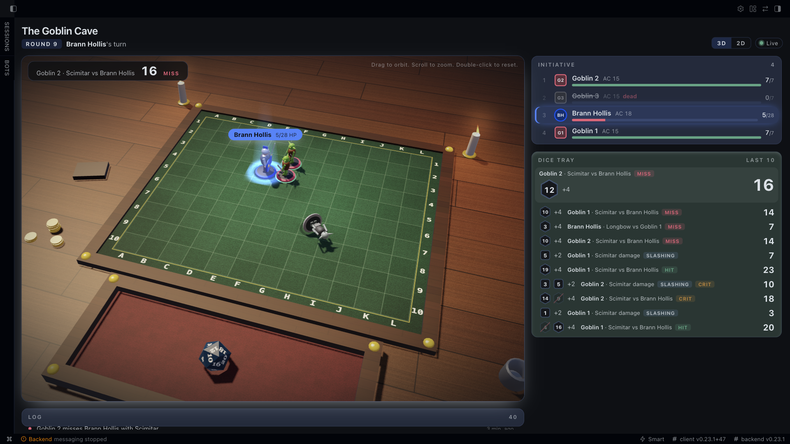

# Tablekeeper

Tablekeeper turns a Hermes chat into a tabletop campaign table. Python rolls every die and owns hit points, positions, initiative and turn order, so the model narrates results it cannot change. Each player controls only the character they claimed, and in combat only on that character's turn. Monsters play their own turns, from SRD 5.1 stat blocks, the moment a player ends theirs.



```text
You:      /table new The Goblin Cave
You:      /table claim fighter
You:      Brann the fighter faces the goblins of the Goblin Cave. Start combat with 3 goblins.
  tk_start_combat -> initiative: Goblin 2 16, Goblin 3 14, Brann 13, Goblin 1 4. Goblin 2's shortbow: d20 20 + 4 = 24 against AC 18, critical, 9 piercing. Goblin 3: d20 10 + 4 = 14, miss.
Hermes:   Goblin 2 fires a shortbow from 55 feet: natural 20, CRITICAL HIT (total 24 vs AC 18) for 9 piercing damage.
          Goblin 3 fires: natural 10 (total 14) vs AC 18, MISSES. Brann Hollis: 19/28 HP. Your turn.
You:      I attack Goblin 3 with my longsword.
  tk_attack         -> Longsword d20 11 + 5 = 16 against AC 15: hit, 12 slashing. Goblin 3 dead.
Hermes:   Longsword attack on Goblin 3 (5 ft, melee): natural 11 (total 16) vs AC 15, HIT for 12 slashing damage. Goblin 3 is slain.
You:      End my turn.
  tk_next_turn      -> Goblin 1 scimitar d20 17 + 4 = 21 against AC 18, hit, 8 slashing. Goblin 2 d20 5 + 4 = 9, miss. Brann 4/28 HP.
Hermes:   Goblin 1 strikes: natural 17 (total 21) vs AC 18, HIT for 8 slashing damage. Goblin 2 strikes: natural 5 (total 9) vs AC 18, MISSES.
          Brann Hollis: 4/28 HP. Your turn.
```
Played live in the Hermes CLI with `nvidia/nemotron-3-ultra-550b-a55b:free` through OpenRouter; the dice are the plugin's.

## What it does

- **Authoritative state.** A SQLite campaign per chat holds every creature, position, condition, initiative slot, roll and log line. A narration guard appends a visible correction when the model states a number no tool produced, a roll a player only claimed, or an action by a creature at 0 HP.
- **SRD 5.1 content.** Thirteen monsters, including the CR 10 young red dragon, four level 3 characters (fighter, rogue, wizard, cleric) and fourteen spells with their SRD numbers, on a 12 by 10 grid at 5 ft per square. Squares carry the labels the Desktop pane shows, columns A-L and rows 1-10, in every tool result, log line and `/table map`. Advantage and disadvantage cancel, critical hits double dice only, resistance halves and rounds down, temporary hit points absorb first, damage at 0 HP costs death saves, concentration is checked, opportunity attacks fire.
- **Monster turns without prompting.** `tk_next_turn` plays every monster turn up to the next player character and returns what each monster did, so the model narrates a complete round from one call.
- **Identity.** The sender comes from the gateway turn context (`HERMES_SESSION_ACTOR_ID`, falling back to `HERMES_SESSION_USER_ID`), and the campaign is keyed by platform and chat id. A message without an identified sender, and any unattended turn such as a cron job, can claim and move nothing. The local CLI, TUI and Desktop user owns every character. Ownership, turn order and game master refusals between different players run in `tests/test_integration.py`, which binds distinct sender ids with the gateway's own session variables.
- **Game master.** The player who starts the campaign adjudicates with `tk_start_combat`, `tk_damage`, `tk_heal`, `tk_condition` and a long `tk_rest`. Players cannot.

## Desktop tabletop

The Tabletop page in Hermes Desktop and the Webapp is a real-time 3D scene drawn by a compact WebGL renderer inside the plugin's single ESM file. It reads the campaign database through the read-only route and changes nothing.

- **The table.** A wooden table lit by a low sun and two candles, a felt board of 12 by 10 squares with columns A-L and rows 1-10 on every edge, soft shadows, fog and a vignette that fades into the app theme.
- **Miniatures.** Seventeen painted looks built from primitives and lit from behind with a warm rim: fighter with sword and shield, hooded rogue, wizard with hat and staff, cleric with mace, goblin, hobgoblin, kobold, wolf, dire wolf, skeleton, zombie, orc, bandit, bandit captain, giant rat, a towering ogre and a young red dragon. The dragon's base spans about 2 by 2 squares in the scene; combat movement and occupancy continue to use one square. Party members take their owner's colour and monsters stand on red bases.
- **State on every base.** A hit point ring, temporary hit point arc, condition gems, a concentration halo, death save pips on a downed character, and a tipped-over greyed miniature when a creature dies. The active creature stands in a spotlight with a floating name plate.
- **Motion from the data.** When a position changes the miniature hops across the board, an attack log entry sends the attacker lunging (or a shot flying for ranged attacks), hit point loss flashes red with a floating damage number, healing flashes green.
- **Dice that tell the truth.** Every roll is thrown into the tray as the matching polyhedron (d4, d6, d8, d10, d12, d20), tumbles, and comes to rest with the rolled value face up. A natural 20 glows gold and a natural 1 glows red. The die you see is the die Python rolled.
- **Camera.** The home shot sits low and close, framing the occupied squares plus one ring of empty ones and easing along as the fight moves. Drag to orbit, scroll to zoom, double-click to recenter. After a few quiet seconds the camera drifts in a slow orbit. Rendering pauses while the pane is hidden.
- **Dice close-up.** A window in the top-right corner shows the tray from above. It swells while a die is in the air and settles back once the rolled face is up, so the number reads on video.
- **Cinematic view.** The CINE switch in the header, or `?cinematic=1` in the address, takes the canvas full-bleed over the host chrome with a HUD for the scene, round, whose turn it is and the last roll. Esc returns to the page.
- **2D board.** A 3D / 2D switch sits in the header, and the page falls back to the SVG board on its own when WebGL is unavailable. The initiative list, dice log and combat log stay in the side column in both views.

## Tools

| Tool | Who | What it does |
|---|---|---|
| `tk_new_campaign` | anyone, then game master | Starts a campaign in this chat. |
| `tk_claim_character` | anyone | Claims fighter, rogue, wizard or cleric. One per player. |
| `tk_state` | anyone | Grid, initiative, HP, positions, conditions, who the sender controls. |
| `tk_roll` | anyone | Plain dice such as `2d6+3` or `4d6kh3`, logged to the dice tray. |
| `tk_check`, `tk_save` | character owner | Ability or skill check, saving throw. |
| `tk_attack` | owner, on their turn | To-hit against AC, cover, damage, range and reach. |
| `tk_cast` | owner, on their turn | Slots, attacks, saves, upcasting, concentration. |
| `tk_move` | owner, on their turn | Speed limited movement to a square label such as `C4` (or `x`, `y`) or toward a creature, opportunity attacks, disengage. `stand: true` gets up from prone for half the speed. |
| `tk_death_save` | owner, on their turn | Death saving throw; ends the turn. |
| `tk_next_turn` | owner of the active character | Ends the turn and plays the monsters. |
| `tk_rest` | owner (short), game master (long) | Hit dice, full recovery. Outside combat. |
| `tk_start_combat` | game master | Spawns monsters at positions, rolls initiative. |
| `tk_damage`, `tk_heal`, `tk_condition` | game master | Rulings for traps, hazards and story effects. |
| `tk_recap` | anyone | The story so far for a previously-on summary. |

A refused action comes back as a result with `refused` and a `message`; the model relays it to the player.

## Command

`/table status`, `/table map`, `/table log`, `/table recap`, `/table claim <character>`, `/table new [scene]`, `/table end`.

`/table map` prints the grid in a monospace block that renders on Telegram and Discord. `/table end` ends the running combat (game master). `/table new confirm` replaces a campaign that already has characters.

## Setup

```bash
hermes plugins install kaverimeshram/tablekeeper/tablekeeper --enable
```

The `tablekeeper` toolset turns on with the plugin. Requires Hermes 0.23.1 or newer. Send `/table new` in the chat where the game happens.

## What it touches

- **Storage.** `<hermes home>/plugin-data/tablekeeper/campaigns.sqlite3`, resolved per profile, WAL mode, file mode 0600. The Desktop pane and dashboard route open it read-only.
- **Prompt.** In a chat that has a campaign, and in a local CLI or Desktop session once it has used `/table` or a `tk_` tool, a compact state summary of at most about 600 tokens is added to each turn and the reply passes through the narration guard. The guard lets a reply quote any hit point or AC figure the state block listed or a tool returned, flags invented damage, rolls and hit points, and appends one compact correction line. A campaign with no table activity for 24 hours adds no prompt tokens until the next `tk_` call or `/table` command wakes it. Other sessions and chats without a campaign are untouched.
- **Network and processes.** None. The plugin makes no network requests, starts no subprocess and reads no credentials.
- **Identity.** Platform, chat id and sender id from the turn context, used as the campaign and owner keys.

## SRD attribution

This work includes material taken from the System Reference Document 5.1 ("SRD 5.1") by Wizards of the Coast LLC and available at https://dnd.wizards.com/resources/systems-reference-document. The SRD 5.1 is licensed under the Creative Commons Attribution 4.0 International License available at https://creativecommons.org/licenses/by/4.0/legalcode. See [NOTICE](NOTICE).

## Tests

```bash
python -m unittest discover -s tests -t .
```

`tests/test_integration.py` loads the plugin through Hermes' own loader in a temporary Hermes home and drives every tool through the registry, including a seeded three round combat, identity and turn refusals, persistence across a reload, per profile storage and the narration guard.
